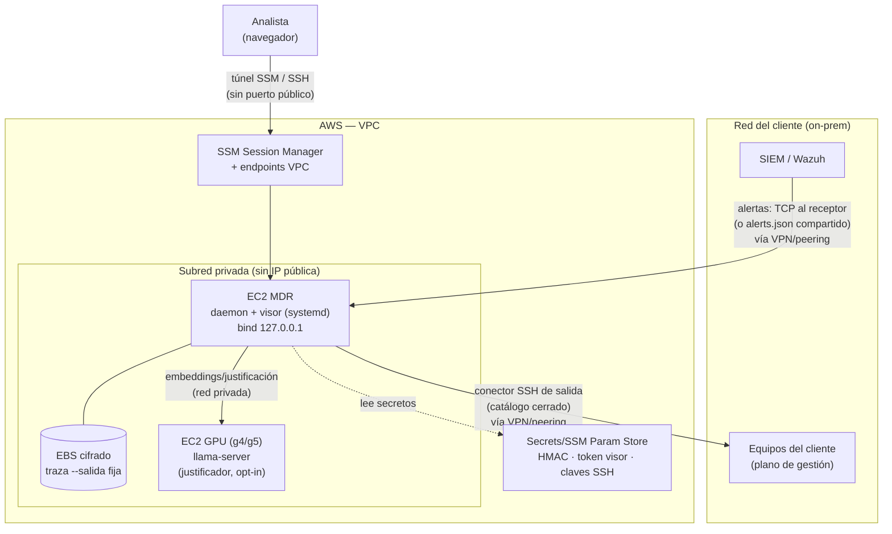

# Despliegue en AWS con OpenTofu — diseño de arquitectura

> **Estado:** diseño + diagrama **y la IaC validada (fase 1 ✓)** en [`infra/aws/`](../../infra/aws/)
> (OpenTofu): `tofu validate` → *Success* (OpenTofu 1.13.2, proveedor AWS 5.100.0). Falta decidir con el
> tutor industrial el *apply* en una cuenta real (alcance/coste; la GPU del LLM es el grueso). Ver también el
> [briefing de la reunión](briefing-reunion-despliegue-aws.md) y [trabajo aplazado](../00-general/v2-trabajo-aplazado.md).
>
> **Alcance elegido:** MDR (daemon) + visor **+ el LLM** justificador. **Herramienta:** OpenTofu
> (HCL; los módulos sirven igual con Terraform).

## 1. Contexto

AWS no rediseña el sistema: es un **destino de despliegue**. El producto desplegable ya existe
—`python3 -m prototipo.servicio.stream … --web` sirviendo el visor construido, con el contrato de
arranque en [`deploy/`](../../deploy/) (unidad `systemd`, `EnvironmentFile`, `--salida` fija para la
persistencia)—. La IaC solo **aprovisiona la infraestructura y arranca eso ahí**, además de resolver
lo que el portátil no puede: **correr el LLM** en una instancia con GPU.

Lo que **no** cambia: el motor de decisión y sus métricas (recall 1.0 / FP 0.009), el carácter
determinista, la traza encadenada con HMAC y ancla, y la postura de *sin egreso* (RNF-01) — que en
la nube se preserva manteniendo todo en **subred privada**.

## 2. Diagrama



Diagrama en texto (por si el visor de Markdown no pinta Mermaid):

```
   Analista ──(túnel SSM/SSH, sin puerto público)──┐
                                                    ▼
  ┌───────────────────────── AWS · VPC ─────────────────────────┐
  │  Subred privada                                              │
  │   ┌───────────────┐   red privada    ┌──────────────────┐   │
  │   │  EC2 MDR       │ ───────────────▶ │ EC2 GPU (LLM)    │   │
  │   │  daemon+visor  │  embeddings/     │ llama-server     │   │
  │   │  bind 127.0.0.1│  justificación   │ (opt-in)         │   │
  │   └──────┬────────┘                   └──────────────────┘   │
  │          │ EBS cifrado (traza, --salida fija)                │
  │   SSM + endpoints VPC · Secrets Manager (HMAC/token/SSH)     │
  └──────▲───────────────────────────────────────────┬──────────┘
         │ alertas (TCP→receptor / alerts.json)       │ conector SSH (salida)
         │                                            ▼
     SIEM/Wazuh del cliente  ◀──VPN/peering──▶  Equipos del cliente
```

## 3. Componente → recurso AWS

| Componente del MDR | Recurso AWS | Notas |
|---|---|---|
| Daemon + visor | **EC2** (t3.small/medium), Amazon Linux | `cloud-init` instala Python 3 + PyYAML, clona el repo e instala la unidad `systemd` de `deploy/` con su `EnvironmentFile`. El visor lo sirve el propio daemon (dist ya construido). |
| Traza (RF-09, retención #9) | **EBS gp3 cifrado** | Montado en la ruta de `--salida` (fija, para que el daemon retome supresión + contenciones al reiniciar). Snapshots EBS = retención/backup. |
| **LLM justificador** | **EC2 GPU** (g4dn.xlarge o g5.xlarge) | `llama-server --embedding` + el modelo; en la subred privada; el daemon lo llama por una URL privada (variable de entorno). **Opt-in y apagable** (es el grueso del coste). |
| Acceso del analista | **SSM Session Manager** / túnel SSH | El daemon se liga a `127.0.0.1` a propósito → **nada expuesto**. Exponerlo exigiría reverse-proxy con TLS + el token que el daemon ya soporta; por defecto, privado. |
| Secretos | **Secrets Manager / SSM Parameter Store** | `TRIAJE_TRAZA_CLAVE` (HMAC), token del visor (#6), credencial del conector SSH. Nunca en la AMI ni en el estado. |
| Red | **VPC + subred privada + SG mínimos** | El SG del LLM solo acepta del SG del MDR; sin ingreso público. **Endpoints VPC** (ssm, ec2messages, s3) para evitar NAT/egreso. |
| Estado de OpenTofu | **local** (tesis) · S3 + DynamoDB lock (equipo/prod) | — |

## 4. Conectividad con el cliente (lo que hace falta de verdad)

El MDR en la nube necesita dos canales hacia el cliente, resueltos con **VPN site-to-site o peering**:
1. **Entrada de alertas:** el SIEM reenvía por **TCP al receptor** del daemon (`--escuchar`, con
   TLS/mTLS opcional ya soportado), o se comparte `alerts.json` (EFS). Sin esto no hay qué triar.
2. **Salida del conector SSH:** el daemon entra al **plano de gestión** del cliente con su catálogo
   cerrado de acciones (mínimo privilegio) para contener. Es egreso **solo hacia el cliente**, no a
   Internet.

## 5. Coste (orden de magnitud)

- EC2 MDR (t3.small) + EBS gp3: bajo (unos pocos € al mes).
- **GPU del LLM: el grueso.** g4dn.xlarge ≈ 0,5 $/h → ~360 $/mes si va 24/7. Mitigaciones de diseño:
  instancia **apagable** (arrancar solo al justificar), **Spot**, o degradar al justificador de
  plantilla (determinista) cuando la GPU no esté — el motor no depende del LLM. Por eso el LLM es un
  **módulo opcional** (`llm_habilitado`), no fijo.

## 6. Estructura de módulos OpenTofu (para cuando se construya)

```
infra/aws/
  main.tf         # provider aws + versiones
  variables.tf    # region, cidr, tipos de instancia, llm_habilitado, llm_tipo…
  network.tf      # VPC, subred privada, SG (MDR, LLM), endpoints VPC
  mdr.tf          # EC2 + EBS + cloud-init (systemd de deploy/)
  llm.tf          # EC2 GPU · count = var.llm_habilitado ? 1 : 0
  iam.tf          # roles mínimos (SSM, lectura de secretos)
  secrets.tf      # referencias a Secrets Manager/SSM (no valores)
  outputs.tf      # id de instancia, comando de túnel SSM
```

Validación sin coste: `tofu validate` + `tofu plan`; **LocalStack** para un `apply` simulado de lo
soportado (VPC/EC2/IAM/SG). `apply` real → cuenta AWS + credenciales + el coste de §5.

## 7. Siguiente paso

Cuando se decida, escribir la IaC de §6 en `infra/aws/` y validarla (offline o `apply`). Hasta
entonces, esto queda como diseño en [trabajo aplazado](../00-general/v2-trabajo-aplazado.md).
