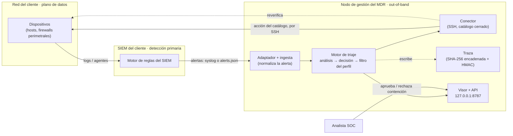

# Integración en producción: configurar el prototipo para el sistema del cliente

> Continuación operativa de [`arquitectura-consolidada.md`](arquitectura-consolidada.md). Aquella describe
> **qué** es el sistema; esta describe **cómo lo configuraríamos para un cliente real** y **qué cambia**
> respecto al laboratorio.

## Idea central

El prototipo **no se despliega como un producto fijo**. Se configura por cliente tocando **tres adaptadores
y un perfil**; la **lógica de decisión no cambia nunca**. Es el principio de los *tres puntos de aislamiento*
de la arquitectura consolidada:

| Punto de aislamiento | En el laboratorio | En producción | Dónde se cambia |
|---|---|---|---|
| **1. Fuente de alertas** | Wazuh (emula el SIEM del cliente) | El SIEM real del cliente | Un adaptador de ingesta (`prototipo/adaptador_wazuh.py` → uno nuevo) |
| **2. Modelo de análisis** | Plantilla determinista (demo) / 8B opcional | El modelo que el hardware del cliente admita | Interfaz `clasificar` / `justificar` |
| **3. Canal hacia el objetivo** | `docker exec … ssh` a nodos Containerlab | SSH real desde el nodo de gestión (o TR-069/ACS para CPE) | El conector (`prototipo/conector.py`) |

> «Cambiar cualquiera de los tres es escribir un adaptador nuevo sin tocar la lógica de decisión.»

Lo que el laboratorio **emula** y en producción es **real**:

- **Wazuh → el SIEM del cliente.** No detectamos: **refinamos** las alertas que el SIEM ya genera (decidimos
  cuáles son amenazas reales y qué hacer). El SIEM sigue siendo del cliente.
- **La red Containerlab del banco → la red real del cliente.** Los 14 nodos del banco son un *stand-in* del
  inventario del cliente (sus hosts, sus firewalls).
- **`docker exec <nodo> ssh …` → SSH real desde el nodo de gestión.** El `docker exec` es un artefacto del
  laboratorio para entrar a los contenedores; en producción el conector abre SSH directamente contra los
  dispositivos del cliente.

---

## 1. Arquitectura de despliegue



**Dónde corre cada pieza.** Todo el MDR vive en **un nodo de gestión out-of-band** (fuera del plano de datos
del cliente): el daemon (`prototipo/stream.py`), el conector, la traza y el visor. Ese nodo necesita:

- **Entrada:** alcanzar el flujo de alertas del SIEM (fichero `alerts.json` seguido como `tail -F`, o un
  receptor syslog — ver §3.2 y §5).
- **Salida:** alcanzar por SSH el **plano de gestión** de los dispositivos del cliente (no el de datos).

**Binding y frontera.** La API y el visor se ligan **solo a `127.0.0.1:8787`** (`tablero.py`). El sistema **no
trae login**: el inicio de sesión, el TLS y el *reverse proxy* los pone la empresa delante (lo nuestro es la
validación de `Host`/`Origin`/CORS; ver §5).

**Un daemon = un cliente.** No hay multi-tenant: cada proceso carga **un** perfil (`stream.py`). Varios clientes
= varios procesos/nodos de gestión, uno por perfil.

---

## 2. Los puntos de configuración por cliente

Configurar el prototipo para un cliente = **escribir su perfil** + **declarar su catálogo y permisos** +
**apuntar la fuente a su SIEM** + **aprovisionar las credenciales del conector**. Ninguno toca el motor.

### 2.1 El perfil del cliente — `prototipo/perfiles/<cliente>.yml`

Es un YAML declarativo. El motor lo consume para decidir *qué se puede automatizar y qué no*. Claves de nivel
superior (ver ejemplos reales en `bancario.yml`, `empresarial.yml`, `residencial.yml`):

| Clave | Qué configura |
|---|---|
| `activos` | Inventario de la red vigilada: `nombre → {ip, funcion, criticidad, servicios_prestados:[puertos], depende_de:[nombres]}`. `criticidad` gobierna la prioridad; `servicios_prestados` son los puertos legítimos (lo demás abierto = exposición); `depende_de` modela la **cascada**. |
| `redes_internas` | CIDR de lo interno; una IP de ese rango no inventariada también es activo interno. |
| `origenes_legitimos` | IPs cuya actividad es legítima (un «ataque» desde ahí es falso positivo). |
| `terceros_confiables` | Socios externos críticos (pasarela de pago, proveedor). Un ataque aparente desde ellos **sí** es amenaza, pero **no se auto-bloquea** (cortarlos tira negocio) → se retiene a humano. |
| `ip_gestion` | El plano de gestión / nodo ejecutor: **ninguna acción puede tocarlo** (veto duro, RF-19). |
| `rafaga` | `{umbral, ventana_s}`: a partir de cuántas alertas del mismo origen en la ventana se trata como ataque **aunque el origen sea legítimo**. |
| `continuidad` | Política de automatización por nivel de impacto (`automatica` / `automatica_si_confianza` / `humano_siempre`), `umbral_confianza`, `reversibilidad_obligatoria` (RF-18), `no_cortar_gestion` (RF-19) y política por tipo de actor. |
| `excepciones` | Puertos de las «joyas de la corona» marcados como `nunca_automatica`. |
| `topologia` | `nodo → {rol, ip, gateway}`. Roles que el motor entiende: `host_victima` (→ `BLOQUEAR_IP`) y `firewall_perimetral` (→ `BLOQUEAR_IP_FIREWALL`). Es la cadena de contención host → fw-core → fw-edge. |
| `rutas` | Enlaza un rol lógico con el destino real del cliente (p. ej. una cola de appsec). |
| `red` | **Solo presentación** de la vista «Red» del visor; la contención no la usa (usa `topologia`). |

Ejemplo (un activo del perfil bancario):

```yaml
activos:
  swift-alliance:
    ip: 10.30.0.10
    funcion: "pasarela SWIFT Alliance (transferencias)"
    criticidad: critica
    servicios_prestados: [48002]
    depende_de: [hsm]
```

**Validación al arrancar.** `perfil.validar` revisa la cordura del perfil (IPs parseables, `depende_de` sin
colgantes, `umbral_confianza` en [0,1], `ip_gestion` presente, etc.) y devuelve **avisos**; **nunca aborta**.
Un perfil incompleto imprime `[aviso] perfil: …` al iniciar el daemon y sigue — diseñado para verlo al arranque
y no fallar en silencio en la primera alerta.

### 2.2 El adaptador del SIEM — la ingesta

El adaptador normaliza la alerta cruda del SIEM al esquema interno `CAMPOS`
(`id_alerta, timestamp, activo, servicio, familia, origen_ip, usuario, mitre, nivel, regla_id, …`). A partir de
ahí el motor es **agnóstico de la fuente**.

**Validar la cobertura antes del go-live.** El mapeo de `adaptador_wazuh.familia_de` asume los grupos/reglas de
Wazuh; si el *ruleset* del cliente difiere, sus alertas caen en `otra` y el motor no actúa. `python3 -m
prototipo.validar_reglas <muestra-alerts.json>` toma una exportación de ejemplo de las alertas del cliente y
reporta cuántas cubre cada familia con playbook y cuáles quedan sin mapear (con su regla/grupos), para afinar
el adaptador en el alta.

Para **enchufar otro SIEM** (el motor no cambia):

1. Escribir **un adaptador nuevo** análogo a `adaptador_wazuh.py` (su propio parseo → `CAMPOS`).
2. Registrarlo con **una línea** en `ingesta.ADAPTADORES = {"wazuh": …, "<nuevo>": …}`.
3. Criterio de éxito: *la misma alerta debe producir la misma decisión*.

Existe un **análisis de segunda fuente (CEF/ArcSight)** —el formato del SIEM comercial que se barajó— en
`archivo/proceso-desarrollo/superpowers/specs/2026-09-21-adaptabilidad-fuente-cef-analisis.md`. Señala cuatro
acoplamientos a Wazuh que hay que resolver antes de una fuente real: (A1) el adaptador va fijado en `stream.py`;
(A2) se hace `json.loads` antes del adaptador (una línea CEF es texto, no JSON); (A3) el campo `nivel_wazuh` se
usa aguas abajo; (A4) el daemon lee fichero/stdin, pero los SIEM reenvían por **syslog** (ver §5, riesgo de
inyección). Quedó **analizado, no implementado**.

### 2.3 El catálogo de acciones y los permisos — `prototipo/catalogo.yml`

El catálogo es el **conjunto cerrado** de acciones que el sistema puede ejecutar (RF-15). Cada acción es una
**plantilla de comando remoto** (iptables, `ss`, `service`, `passwd`, `tc`, …) con metadatos:

```yaml
BLOQUEAR_IP:
  categoria: contencion
  impacto: localizado
  reversion: definida
  comando:      "iptables -A INPUT -s {ip} -j DROP"
  reversion_cmd: "iptables -D INPUT -s {ip} -j DROP"
  verificacion: "iptables -L -n | grep DROP | grep -wF -- {ip}"
```

- Flags de seguridad por acción: `nunca_automatica: true` (p. ej. `FORZAR_CAMBIO_PASS`, `AISLAR_NODO`,
  `REINICIAR_NODO` → **jamás** automáticas aunque el perfil lo permita) y `corta_gestion_si: ssh` (veto duro si
  el perfil pide `no_cortar_gestion`).
- Las acciones corren **en el nodo objetivo** (el activo atacado o el firewall perimetral de la `topologia`),
  no en el SIEM.

**Permisos de mínimo privilegio, derivados del catálogo.** El catálogo cerrado es también la frontera de
privilegio en el nodo. `catalogo.py` **genera el sudoers** a partir de él:

```bash
python3 -m prototipo.catalogo --sudoers triaje \
    --rutas iptables=/sbin/iptables,service=/usr/sbin/service,passwd=/usr/bin/passwd \
    --allowlist service=nginx:apache2,passwd=appuser
```

Emite líneas `triaje ALL=(root) NOPASSWD: /sbin/iptables -A INPUT -s * -j DROP`, etc. La `--allowlist`
restringe los comodines de **servicio/cuenta** a valores concretos (no `service * stop`); `{ip}`/`{puerto}`
quedan como comodín por naturaleza. El usuario del conector **solo puede ejecutar lo que el catálogo define**.

### 2.4 El conector y las credenciales — `prototipo/conector.py`

Ejecuta las órdenes con el patrón **verificar → actuar → reverificar** (idempotente: si ya está en el estado
deseado, no re-ejecuta). Hay **dos ejecutores**:

- `ejecutor_ssh_lab` — **solo laboratorio** (`sshpass` + usuario/contraseña de Metasploitable). **No usar en
  producción.**
- `ejecutor_ssh_clave` — **diseño de producción**: usuario SSH dedicado, clave privada, *host* verificado
  (`StrictHostKeyChecking=yes`, `UserKnownHostsFile`), `BatchMode`/`PasswordAuthentication=no`, sin contraseña
  viajando; `sudo` acotado por el sudoers generado del catálogo.

Configuración por variables de entorno en el nodo de gestión:

| Variable | Para qué |
|---|---|
| `TRIAJE_NODO_GESTION` | Nodo desde el que sale el SSH (el nodo de gestión). |
| `TRIAJE_SSH_MODO` | `clave` (producción) \| `password` (solo lab). |
| `TRIAJE_SSH_USUARIO` | Usuario dedicado (p. ej. `triaje`). |
| `TRIAJE_SSH_CLAVE` | Ruta de la clave privada. |
| `TRIAJE_SSH_KNOWN_HOSTS` | Fichero de *host keys* verificadas. |

**Fail-closed.** Si no hay credencial ni modo explícito, el conector **no ejecuta nada** (rc 126); **no** cae a
la contraseña de laboratorio (eso ocultaría una producción mal configurada). Además sanea la inyección: exige
IP real y rechaza `None`/metacaracteres/valores que empiecen por `-`.

> **Honesto:** `ejecutor_ssh_clave` existe en código pero **no se ha ejercitado contra dispositivos reales**
> (el laboratorio usa el ejecutor de contraseña vía `docker exec`). Validarlo contra un dispositivo de verdad
> es parte del rollout (ver §6).

### 2.5 El arranque del daemon — `prototipo/stream.py`

```bash
# Producción (esquema): el SIEM reenvía alertas; el daemon las sigue y sirve el visor.
export TRIAJE_SSH_MODO=clave
export TRIAJE_SSH_USUARIO=triaje
export TRIAJE_SSH_CLAVE=/ruta/clave_triaje
export TRIAJE_SSH_KNOWN_HOSTS=/ruta/known_hosts
export TRIAJE_NODO_GESTION=<nodo-de-gestion>

tail -n0 -F /ruta/al/alerts.json \
  | python3 -m prototipo.stream - prototipo/perfiles/<cliente>.yml <hallazgos.json> --web
```

- **Posicionales:** fuente (`-` = stdin), perfil, hallazgos de postura (Nmap del auditor; opcional según
  cliente).
- **Flags útiles:** `--web [puerto]` (visor, def. 8787), `--con-llm` (justificador LLM si el hardware lo
  admite), `--agente` (agente ReAct en vez del lazo determinista), `--sin-supresion`, `--ventana-agrupacion N`,
  `--salida <traza.jsonl>`.
- **Recibir del SIEM por red (en vez de `tail`):** `--escuchar host:puerto` levanta un receptor **TCP**;
  `--permitir ip,ip` es la **lista blanca** de IPs del SIEM (solo esas se aceptan; mitiga la inyección de
  alertas falsas), y `--tls-cert/--tls-clave` activan TLS (o se termina en un proxy delante). El emisor envía
  un JSON de alerta por línea (el mismo formato de `alerts.json`).
- **Reloj (NTP):** el MDR normaliza la zona/formato de los timestamps a UTC para la correlación de ráfaga,
  pero el cliente debe tener **NTP** entre el SIEM, el MDR y los dispositivos: un reloj que deriva de verdad no
  lo corrige el código.
- La respuesta del analista en terminal se lee de `/dev/tty` (no de stdin), para no consumir alertas del *pipe*.
- Un cambio en el backend requiere **reiniciar el daemon**; el `dist` del visor se sirve por petición (basta
  `npm run build`).
- **`--salida` estable.** El daemon reconstruye su estado (supresión y contenciones activas) de la traza que
  retoma al arrancar. Para que un reinicio recupere ese estado, usa un `--salida` **fijo** por cliente (p. ej.
  `run/trazas-<cliente>.jsonl`), no un nombre por arranque; así la traza de varias sesiones es una sola cadena y
  el reinicio no «olvida» qué estaba bloqueado.
- **Servicio supervisado + healthcheck.** En producción el daemon corre como servicio **systemd**
  (`Restart=on-failure`) y expone `GET /healthz` con la salud del propio MDR (vitalidad del lazo + silencio de
  ingesta) para un monitor local. Plantillas de unidad, wrapper del *pipe* y `EnvironmentFile` en **`deploy/`**
  (ver `deploy/README.md`).

---

## 3. Alta de un cliente nuevo — checklist

1. **Inventariar la red del cliente** → escribir `prototipo/perfiles/<cliente>.yml`: `activos` (ip, función,
   criticidad, servicios, dependencias), `redes_internas`, `topologia` (host_victima + firewall_perimetral),
   `ip_gestion`.
2. **Declarar la tolerancia al riesgo** → bloque `continuidad` (qué nivel de impacto se automatiza, umbral de
   confianza), `terceros_confiables`, `origenes_legitimos`, `excepciones` (joyas de la corona), `rafaga`.
3. **Apuntar la fuente a su SIEM** → si es Wazuh, seguir su `alerts.json`; si es otro, escribir el adaptador
   (§2.2) y registrarlo en `ingesta.ADAPTADORES`.
4. **Aprovisionar el conector** → crear el usuario SSH dedicado y su clave en el nodo de gestión, registrar las
   *host keys* de los dispositivos, y **generar el sudoers** desde el catálogo (`--sudoers`, §2.3) con la
   `--allowlist` del cliente.
5. **Arrancar en seco** → correr el daemon **sin `--con-llm`** y revisar los `[aviso] perfil:` del arranque;
   lanzar alertas de prueba y comprobar las decisiones en el visor **antes** de dar permisos de ejecución
   reales.
6. **Habilitar la contención gradualmente** → empezar con todo a `humano_siempre`; subir a
   `automatica_si_confianza` por nivel de impacto a medida que se gana confianza.
7. **Poner el frente de la empresa** → login, TLS y *reverse proxy* delante del `127.0.0.1:8787` (§5).

---

## 4. Postura de seguridad

**Ya endurecido** (auditoría interna del propio MDR):

- **Visor/API:** ligado solo a `127.0.0.1`; valida `Host` (anti DNS-rebinding), exige `Origin` local en los
  POST (anti-CSRF), CORS **no** es `*` (una web ajena no puede leer el estado del SOC), tope de cuerpo POST.
- **Traza:** cadena SHA-256 *tamper-evident*, firma **HMAC** opcional (`TRIAJE_TRAZA_CLAVE`), fichero `0600`,
  **ancla externa** por syslog a Wazuh para detectar truncado.
- **Conector/catálogo:** catálogo cerrado = frontera de acciones **y** de privilegio; sudoers de mínimo
  privilegio; saneamiento anti-inyección; **fail-closed** sin credencial.
- **Motor/perfil:** acciones `nunca_automatica` jamás automáticas; reversibilidad obligatoria; no cortar el
  plano de gestión; terceros de confianza y externos desconocidos retenidos a humano; veto si no hay IPv4 de
  origen.
- **Kill switch:** pausa global de la automatización (todo pasa a esperar aprobación) y des-bloqueo en masa
  desde el visor (`/api/pausa`, `/api/revertir-todo`), para frenar y revertir al instante si el MDR se
  equivoca. Las reglas de enganche por escrito (qué se puede bloquear y cuándo) las define la empresa.

**Trabajo futuro (lo pone/valida la empresa en el rollout):**

- **Login/autenticación** del tablero (hoy no hay; solo defensas `Host`/`Origin`/CORS).
- **TLS y canal de alertas seguro**: si se recibe por syslog, el UDP es *spoofable* (una alerta falsa puede
  convertir el auto-bloqueo en un arma de DoS). Mitigaciones: syslog **TCP + TLS** y lista blanca de IPs del
  SIEM.
- **Multi-tenant**: hoy un perfil por proceso.
- **Canal de respuesta real**: sustituir el `docker exec` del laboratorio por SSH directo (o TR-069/ACS para
  CPE), y **validar `ejecutor_ssh_clave` contra dispositivos reales**.
- **TTL de bloqueos** (caducado automático de las contenciones).

---

## 5. Listo vs. trabajo futuro (resumen honesto)

| Componente | Estado |
|---|---|
| Motor de decisión + triaje | **Listo y probado** (suites en verde; métricas canónicas estables). |
| Configuración por perfil (los *seams*) | **Lista**: perfil, catálogo, sudoers generado, adaptador agnóstico. |
| Endurecimiento del propio MDR | **Hecho** (CORS/CSRF/Host, HMAC, sudoers, fail-closed, nunca-automáticas). |
| Conector de producción (`ejecutor_ssh_clave`) | **Diseñado, en código; sin ejercitar contra equipos reales.** |
| Segunda fuente de SIEM (CEF) | **Analizada, no implementada.** |
| Login / TLS / multi-tenant / TTL de bloqueos | **Trabajo futuro** (parte, de la empresa). |

> En una palabra: **el núcleo que decide y el modo de configurarlo por cliente están listos y endurecidos**; lo
> que falta para un cliente real es *operativo de rollout* (credenciales reales, canal de alertas seguro, el
> frente de autenticación de la empresa) y validar el canal SSH de producción contra dispositivos de verdad.

El detalle de lo pendiente —los puntos a cerrar para pasar de prototipo a producto final, con estado, criterio
de cierre y orden— está en la **[hoja de ruta a producción](hoja-de-ruta-a-produccion.md)**, que se aborda
progresivamente. Lo que debe aportar o decidir la **empresa/cliente** (autorización para actuar, auditor,
hardware del modelo, vault, control de cambios), con plantillas, está en
**[requisitos del cliente y gobernanza](requisitos-del-cliente-y-gobernanza.md)**.
